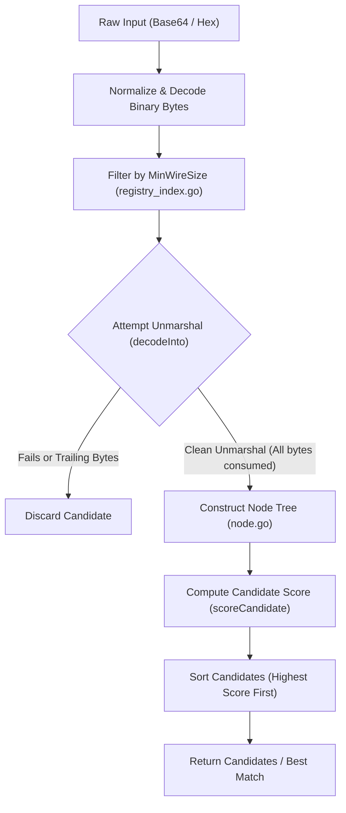

# XDR Type Detection Heuristics & Scoring Engine

`stellar-xdr-lens` (`lens`) can take an arbitrary, untyped base64 or hexadecimal XDR payload and automatically infer its exact XDR type across all registered protocol types. This capability eliminates the need for users to manually guess or supply flags like `--type TransactionEnvelope` when exploring unknown Stellar data.

This document details the multi-stage heuristic scoring engine, ambiguity resolution rules, wire-size filters, and step-by-step procedures for registering new XDR types.

---

## Table of Contents

- [The Detection Pipeline](#the-detection-pipeline)
- [Multi-Stage Scoring Model](#multi-stage-scoring-model)
  - [1. Candidate Unmarshaling & Complete Consumption](#1-candidate-unmarshaling--complete-consumption)
  - [2. Base Priority Weighting](#2-base-priority-weighting)
  - [3. Structural Node Count Heuristic](#3-structural-node-count-heuristic)
  - [4. Small Payload Damping](#4-small-payload-damping)
  - [Scoring Formula](#scoring-formula)
- [Ambiguity Resolution & Wire Collisions](#ambiguity-resolution--wire-collisions)
  - [The 4-Byte Collision (`AAAAAA==`)](#the-4-byte-collision-aaaaaa)
  - [The 32-Byte Payload Ambiguity](#the-32-byte-payload-ambiguity)
  - [Wire-Identical Aliases (Bucket Entries & Soroban)](#wire-identical-aliases-bucket-entries--soroban)
  - [Inspecting Candidates with `--candidates`](#inspecting-candidates-with---candidates)
- [Step-by-Step Guide: Registering a New XDR Type](#step-by-step-guide-registering-a-new-xdr-type)
  - [Step 1: Add to the Type Registry](#step-1-add-to-the-type-registry)
  - [Step 2: Assign Category & MinWireSize in Registry Index](#step-2-assign-category--minwiresize-in-registry-index)
  - [Step 3: Register Enricher (Optional)](#step-3-register-enricher-optional)
  - [Step 4: Author Detection & Roundtrip Tests](#step-4-author-detection--roundtrip-tests)
- [Summary of Priority Tiers](#summary-of-priority-tiers)

---

## The Detection Pipeline

The detection engine evaluates an incoming base64 or hex string against registered types in a multi-stage pass:



---

## Multi-Stage Scoring Model

### 1. Candidate Unmarshaling & Complete Consumption

Each registered type attempts to unmarshal the payload using the official `github.com/stellar/go-stellar-sdk/xdr` unmarshaler.
- **Strict Byte Consumption:** If unmarshaling succeeds but does not consume all bytes in the buffer, the candidate is discarded. XDR is a strictly framed binary format; trailing bytes signify an incomplete or mismatched type match.
- **Error Discard:** Any unmarshal failure (unknown union discriminant, unexpected EOF, out-of-bounds slice length) immediately excludes the candidate.

### 2. Base Priority Weighting

Every registered type is assigned an intrinsic `priority` integer (ranging from `1` to `100`):
- Types that developers frequently inspect in a terminal (e.g. `TransactionEnvelope` = 100, `TransactionResult` = 95, `TransactionMeta` = 90) receive top priority.
- Intermediate or primitive types (e.g. `DecoratedSignature` = 12, `SignerKey` = 4, `Hash` = 3) receive lower priority.
- This prevents a 44-byte transaction envelope from incorrectly matching an inner sub-structure.

### 3. Structural Node Count Heuristic

When multiple types cleanly decode a payload, the candidate that explains more structural complexity is favored:
- The neutral `Node` tree is recursively counted via `countNodes(n *Node)`.
- A complex struct with 15 nested fields scores higher than a flat 1-element wrapper.

### 4. Small Payload Damping

Very short payloads (such as 4-byte or 8-byte inputs) carry negligible structural entropy. In payloads where `len(rawBytes) <= 8`, the structural node count term is damped out:
- This ensures that ambiguous small payloads are ranked strictly by curated priority rather than arbitrary node counts.

### Scoring Formula

In `pkg/lens/decode.go`:

```go
func scoreCandidate(t xdrType, v *Value, rawLen int) int {
	score := t.priority * 1000
	score += countNodes(v.Node)
	if rawLen <= 8 {
		score = t.priority * 1000
	}
	return score
}
```

| Factor | Weight | Purpose |
|---|---|---|
| `t.priority * 1000` | Dominant | Enforces curated precedence for common protocol objects. |
| `countNodes(v.Node)` | Secondary (+1 per node) | Rewards structural completeness and deeper type trees. |
| Damping (`rawLen <= 8`) | Normalization | Keeps small inputs deterministic and stable against noise. |

---

## Ambiguity Resolution & Wire Collisions

XDR serialization maps distinct schema types to identical binary layouts when their fields have matching primitive widths.

### The 4-Byte Collision (`AAAAAA==`)

Four zero bytes (`0x00 0x00 0x00 0x00`) cleanly decode as multiple distinct Stellar types:
1. `Memo`: `MEMO_NONE` (discriminant 0)
2. `Asset`: `ASSET_TYPE_NATIVE` (discriminant 0, XLM)
3. `Auth`: 4-byte authentication flags (all bits zero)
4. `ScVal`: `ScValTypeVoid`

**Resolution:**
The curated priorities in `pkg/lens/decode.go` break the tie:
- `Memo`: Priority 25 (Rank 1)
- `Asset`: Priority 10 (Rank 2)
- `Auth`: Priority 2 (Rank 3)

### The 32-Byte Payload Ambiguity

A raw 32-byte binary payload can be validly decoded as:
- `Hash` (SHA-256 hash or contract ID)
- `AccountID` (Ed25519 public key)
- `SignerKey` (Ed25519 signer key)
- `DontHave` (Overlay message payload)
- `LedgerKey` or `TTLEntry` (under certain discriminants)

**Resolution:**
- `AccountID` is assigned priority 30, ranking it above bare `SignerKey` (4) and `Hash` (3).
- When a user intends to decode an opaque 32-byte string as a cryptographic hash, they supply `--type Hash` explicitly.

### Wire-Identical Aliases (Bucket Entries & Soroban)

- **`HotArchiveBucketEntry` vs `BucketEntry`:** An archival bucket entry shares an identical discriminant layout with live bucket entries. `BucketEntry` (Priority 8) ranks above `HotArchiveBucketEntry` (Priority 7).
- **`BucketMetadata` vs `ScVal`:** Certain integer-heavy bucket metadata encodings match wide `ScVal` numbers. Priority separation ensures bucket lists are inspected correctly when processing ledger history archives.

### Inspecting Candidates with `--candidates`

Users can inspect all matching candidate types and their rankings using the `--candidates` flag:

```console
$ lens decode --candidates "AAAAAA=="
* Memo
  Asset
  Auth

3 types matched; the starred one is used by default. Use --type to choose.
```

---

## Step-by-Step Guide: Registering a New XDR Type

Adding a new XDR type is fully decoupled and requires editing only two files.

### Step 1: Add to the Type Registry

In `pkg/lens/decode.go`, add an entry to the `registry` slice:

```go
// In pkg/lens/decode.go
var registry = []xdrType{
    // ...
    {"NewFeatureEntry", func() any { return new(xdr.NewFeatureEntry) }, 45},
}
```

- Choose a priority between 1 and 100 based on how likely users are to supply this type in a CLI command.

### Step 2: Assign Category & MinWireSize in Registry Index

In `pkg/lens/registry_index.go`, register metadata for `lens types` and fast-path size checks:

```go
// In pkg/lens/registry_index.go
var registryIndex = map[string]TypeInfo{
    // ...
    "NewFeatureEntry": {
        Category:    CategoryLedgerEntry,
        Description: "Records protocol 23 state metadata",
        Priority:    45,
        MinWireSize: 16,
    },
}
```

### Step 3: Register Enricher (Optional)

If the new type has fields that should be rendered with human-readable notes (e.g. strkey addresses or stroop amounts), add an enricher in `pkg/lens/`:

```go
func init() {
    enricherFor[reflect.TypeOf(xdr.NewFeatureEntry{})] = enrichNewFeatureEntry
}
```

### Step 4: Author Detection & Roundtrip Tests

Add a test case in `pkg/lens/decode_test.go`:

```go
func TestDetectNewFeatureEntry(t *testing.T) {
    t.Parallel()
    payload := "AAAA..." // base64 fixture
    candidates, err := lens.Detect(payload)
    if err != nil {
        t.Fatalf("Detect error = %v", err)
    }
    if len(candidates) == 0 || candidates[0].Type != "NewFeatureEntry" {
        t.Errorf("expected NewFeatureEntry as top candidate, got %v", candidates[0].Type)
    }
}
```

---

## Summary of Priority Tiers

| Priority Range | Category | Representative Types |
|---|---|---|
| **90 – 100** | Top Transactions | `TransactionEnvelope`, `TransactionResult`, `TransactionMeta` |
| **80 – 89** | Ledger & History | `LedgerCloseMeta`, `LedgerHeaderHistoryEntry`, `TransactionHistoryEntry` |
| **50 – 79** | Operations & State | `Operation`, `LedgerEntry`, `ScVal`, `ContractCodeEntry` |
| **20 – 49** | Sub-components | `Memo`, `AccountID`, `ClaimableBalanceEntry`, `ConfigSettingEntry` |
| **1 – 19** | Primitives & Keys | `SignerKey`, `Hash`, `Signature`, `PoolId`, `Auth` |
