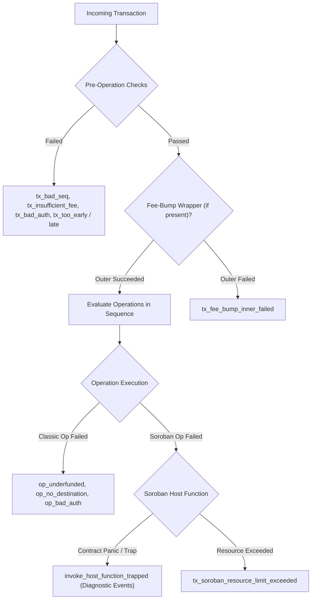

# Debugging Failed Stellar & Soroban Transactions with `lens explain`

When a Stellar transaction fails on Horizon or Soroban RPC, the error message returned is often a terse, nested result code like `tx_failed` wrapping `op_inner` wrapping `op_underfunded`. In complex multi-operation bundles or Soroban contract invocations, pinpointing the exact failure cause requires correlating the envelope with its result, reconstructing ledger reserve requirements, inspecting signature hint discrepancies, and parsing diagnostic host events.

`lens explain` automates this diagnosis offline, pinpointing failing operations, calculating exact mathematical balance shortfalls, verifying signer weights, and explaining Soroban contract panics in plain English.

---

## Table of Contents

- [The Hierarchy of Stellar Transaction Failures](#the-hierarchy-of-stellar-transaction-failures)
  - [1. Pre-Operation Transaction Checks](#1-pre-operation-transaction-checks)
  - [2. Fee-Bump Wrappers & Inner Results](#2-fee-bump-wrappers--inner-results)
  - [3. Operation-Level Rejections](#3-operation-level-rejections)
  - [4. Soroban VM Traps & Diagnostics](#4-soroban-vm-traps--diagnostics)
- [Deep Diagnostic Features in `lens explain`](#deep-diagnostic-features-in-lens-explain)
  - [Failure Isolation (`--isolate`)](#failure-isolation---isolate)
  - [Balance & Reserve Shortfall Diagnostics (`balance_explain.go`)](#balance--reserve-shortfall-diagnostics-balance_explaingo)
  - [Signature & Weight Threshold Verification (`signature_explain.go`)](#signature--weight-threshold-verification-signature_explaingo)
  - [Correlating Soroban VM Traps (`trap_reasons.go`)](#correlating-soroban-vm-traps-trap_reasonsgo)
  - [Precondition & Timebound Expiration (`--check-expiry`)](#precondition--timebound-expiration---check-expiry)
- [Cookbook of Common Failure Scenarios](#cookbook-of-common-failure-scenarios)
  - [Scenario 1: `op_underfunded` with Reserve Math](#scenario-1-op_underfunded-with-reserve-math)
  - [Scenario 2: `op_bad_auth` with Signer Hint Diagnostics](#scenario-2-op_bad_auth-with-signer-hint-diagnostics)
  - [Scenario 3: `tx_soroban_invalid` & Contract Panics](#scenario-3-tx_soroban_invalid--contract-panics)
  - [Scenario 4: Fee-Bump Inner Failure](#scenario-4-fee-bump-inner-failure)
- [Useful Diagnostic Flags Reference](#useful-diagnostic-flags-reference)

---

## The Hierarchy of Stellar Transaction Failures

Stellar evaluates transactions in a strict, layered sequence. Understanding where a transaction halted is critical to resolving it:



### 1. Pre-Operation Transaction Checks
Occurs before any operation logic runs:
- Sequence numbers (`tx_bad_seq` / `tx_bad_minseq`).
- Fee bids (`tx_insufficient_fee`).
- Top-level signature validity (`tx_bad_auth`).
- Preconditions (`tx_too_early`, `tx_too_late`).

### 2. Fee-Bump Wrappers & Inner Results
When a transaction is wrapped in a Fee-Bump envelope (`TransactionEnvelopeV0`/`V1` inside a Fee-Bump wrapper):
- The outer transaction pays the fee.
- If the inner transaction fails, the outer result is `tx_fee_bump_inner_failed`, but the fee is still charged to the fee-bump source.
- `lens explain` automatically extracts and analyzes the inner result.

### 3. Operation-Level Rejections
Operations execute sequentially in all-or-nothing atomicity. If operation `i` fails, all preceding mutations roll back, but the transaction fee is consumed.

### 4. Soroban VM Traps & Diagnostics
Soroban contracts execute inside the WebAssembly VM. Rejections can stem from:
- Explicit contract panic: `panic!("unauthorized")`.
- Resource exhaustion: exceeding CPU instructions, RAM limit, or ledger read/write bytes.
- Expired state: trying to read evicted or un-restored storage.

---

## Deep Diagnostic Features in `lens explain`

### Failure Isolation (`--isolate`)

When transactions contain dozens of operations, locating the failure by hand is tedious. Pass `--isolate` to pinpoint the exact failure index:

```console
$ lens explain "$ENVELOPE_XDR" --result "$RESULT_XDR" --isolate
```

Output:
```text
Operation 2 failed: payment (payment_underfunded)
  → The source account does not hold enough of the asset to send this amount.
  → All failed operation indices: [2]
```

In `pkg/lens/op_isolator.go`, `IsolateFailure` categorizes the failure stage (`StagePreOperation`, `StageOperation`, `StageFeeBumpInner`), ensuring automated monitoring tools can alert the correct subsystem.

### Balance & Reserve Shortfall Diagnostics (`balance_explain.go`)

A common mistake is assuming that an account with 10 XLM can transfer 10 XLM. Stellar accounts must retain a **base reserve**:
$$\text{Reserve} = (2 + \text{numSubentries}) \times \text{BaseReserve} + \text{SellingLiabilities}$$

`lens.DiagnoseBalance` calculates the exact mathematical shortfall:

```console
$ lens explain --file env.xdr --result-file res.xdr --verbose
Payment failed (op_underfunded):
  Total Balance:        15.5000000 XLM
  Base Reserve:         0.5000000 XLM
  Subentries (4):       2.0000000 XLM (2 trustlines, 1 signer, 1 data entry)
  Minimum Reserve:      3.0000000 XLM
  Selling Liabilities:  10.0000000 XLM (locked in active DEX offers)
  Available to Spend:   2.5000000 XLM
  Attempted Spend:      5.0000000 XLM
  Shortfall:            2.5000000 XLM (25000000 stroops)
```

### Signature & Weight Threshold Verification (`signature_explain.go`)

Stellar enforces three operation threshold levels:
- **Low:** `BumpSequence`, `SetTrustLineFlags`, `AllowTrust`.
- **Medium (Default):** `Payment`, `CreateAccount`, `ChangeTrust`, `InvokeHostFunction`.
- **High:** `AccountMerge`, `SetOptions` (signer modifications).

`pkg/lens/signature_explain.go` checks whether signatures meet the required threshold:

```console
$ lens explain "$ENVELOPE" --result "$RESULT"
Transaction failed with op_bad_auth on operation 0 (set_options):
  Required Threshold: High (weight required: 20)
  Supplied Signers:
    - Key GA2J... (weight: 10, signed: true)
  Total Weight Reached: 10
  Shortfall: 10 additional weight required.
```

### Correlating Soroban VM Traps (`trap_reasons.go`)

When a Soroban contract traps, the result code is simply `InvokeHostFunctionResultCodeInvokeHostFunctionTrapped`. To find out *why*, pass `--meta` with the `TransactionMeta` payload:

```console
$ lens explain "$ENV_XDR" --result "$RES_XDR" --meta "$META_XDR"
```

Output:
```text
Transaction failed at operation 0, invoke_host_function (call swap on contract CBGSB...):
The contract trapped during host function execution.
Diagnostic Event Log:
  Contract: CBGSB...
  Event Type: Diagnostic
  Topic: "error"
  Data: "SlippageExceeded: minimum amount out was 250000000, got 248102000"
```

### Precondition & Timebound Expiration (`--check-expiry`)

Verify whether a transaction expired before ledger submission:

```console
$ lens explain "$ENVELOPE_XDR" --check-expiry --reference-time "2026-11-20T21:00:00Z"
Precondition Check:
  Precondition Type: TimeBounds
  Valid Range: 2026-11-20T19:00:00Z to 2026-11-20T20:30:00Z
  Reference Time: 2026-11-20T21:00:00Z
  Status: EXPIRED (transaction expired 30 minutes before reference time)
```

---

## Cookbook of Common Failure Scenarios

### Scenario 1: `op_underfunded` with Reserve Math

**Symptom:** Payment or account creation fails with `op_underfunded`.
**Root Cause:** The account has enough nominal balance, but liabilities or subentry reserves lock the funds.
**Fix:** Reduce open DEX orders or deposit additional native XLM to meet minimum reserves.

### Scenario 2: `op_bad_auth` with Signer Hint Diagnostics

**Symptom:** Multi-signature transaction fails with `op_bad_auth`.
**Root Cause:** The transaction was signed by a key that is either not a registered signer or has insufficient weight for the operation threshold.
**Inspection:**
```console
$ lens explain "$ENVELOPE_XDR" --result "$RESULT_XDR" --verbose
```

### Scenario 3: `tx_soroban_invalid` & Contract Panics

**Symptom:** Smart contract invocation returns `tx_soroban_invalid` or `invoke_host_function_trapped`.
**Root Cause:** Missing ledger footprint entries, expired contract TTL, or internal contract assertion failure.
**Inspection:** Always provide `--meta` to correlate diagnostic events.

### Scenario 4: Fee-Bump Inner Failure

**Symptom:** Outer result reports `tx_fee_bump_inner_failed`.
**Root Cause:** The fee-bump wrapper succeeded in paying the fee, but the inner transaction failed.
**Inspection:** `lens explain` parses the inner envelope and pinpoints the failing inner operation.

---

## Useful Diagnostic Flags Reference

| Flag | Purpose | Example |
|---|---|---|
| `--result`, `--result-file` | Attach `TransactionResult` to explain concrete failure codes. | `lens explain --file env.xdr --result-file res.xdr` |
| `--meta`, `--meta-file` | Attach `TransactionMeta` for Soroban diagnostic events. | `lens explain --file env.xdr --meta-file meta.xdr` |
| `--isolate` | Pinpoint the exact failing operation index. | `lens explain "$ENV" --result "$RES" --isolate` |
| `--resources` | Soroban resource breakdown compared against network limits. | `lens explain "$ENV" --resources` |
| `--check-expiry` | Verify timebounds and ledger bounds validity. | `lens explain "$ENV" --check-expiry` |
| `--fail-on-error` | Exit code 2 if transaction failed (ideal for CI gates). | `lens explain "$ENV" --result "$RES" --fail-on-error` |
| `--markdown` | Emit GitHub-flavored Markdown report. | `lens explain "$ENV" --result "$RES" --markdown > report.md` |
| `--json` | Emit structured JSON diagnostic report for automated pipelines. | `lens explain "$ENV" --result "$RES" --json` |
