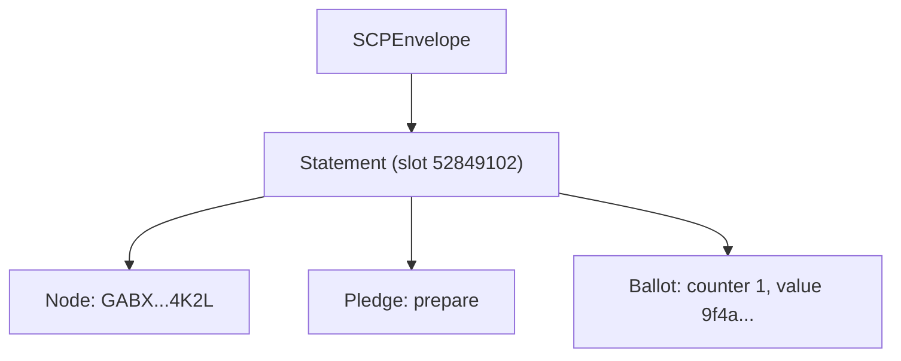
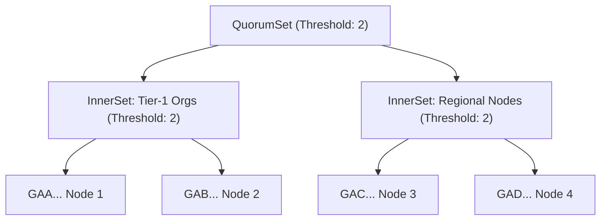

# Consensus and SCP Diagnostics Reference

The Stellar Consensus Protocol (SCP) is the federated Byzantine agreement mechanism underpinning the Stellar network. Rather than relying on closed membership or proof-of-work/stake, SCP allows validator nodes to independently choose their trusted slices (*quorum slices*), forming a global quorum through slice intersection.

`stellar-xdr-lens` provides offline inspection, decoding, enrichment, and visualization for SCP envelopes and consensus messages without requiring a live node or network access.

---

## 1. SCP Message Architecture & Types

SCP messages are exchanged in nested XDR structures:

```
SCPEnvelope
 ├── statement: SCPStatement
 │    ├── nodeID: NodeId (PublicKey)
 │    ├── slotIndex: Uint64 (Ledger Sequence)
 │    └── pledges: SCPStatementPledges (Union)
 │         ├── NOMINATE:     SCPNomination
 │         ├── PREPARE:      SCPStatementPrepare
 │         ├── CONFIRM:      SCPStatementConfirm
 │         └── EXTERNALIZE:  SCPStatementExternalize
 └── signature: Signature (Ed25519 signature over statement)
```

### Statement Types (`SCPStatementType`)

A consensus round for a specific ledger slot advances through two primary sub-protocols: **Nomination** and **Ballot Protocol** (Prepare, Confirm, Externalize).

| Statement Type | Value | Protocol Stage | Description |
|---|---|---|---|
| `NOMINATE` | 0 | Nomination | Proposes candidate transaction sets (`votes`) and acknowledges candidates that have reached nomination consensus (`accepted`). |
| `PREPARE` | 1 | Ballot (Prepare) | Pledges to prepare a specific ballot `b = (counter, value)`. Tracks prepared ballots (`p`, `p'`), candidate values, and commit counter bounds (`nC`, `nH`). |
| `CONFIRM` | 2 | Ballot (Confirm) | Commits to ballot `b` once a quorum confirms preparation. Narrows the candidate interval and signals readiness to externalize. |
| `EXTERNALIZE` | 3 | Ballot (Externalize) | Reaches final consensus. Commits value `commit` at counter `commit.counter` and reveals the validator's `SCPQuorumSet` hash for post-hoc verification. |

### Quorum Sets (`SCPQuorumSet`)

An `SCPQuorumSet` defines a node's voting policy and trust dependencies:

```
SCPQuorumSet:
  threshold:  uint32           # Minimum agreements needed among validators + innerSets
  validators: []NodeId         # Direct validator public keys (Ed25519)
  innerSets:  []SCPQuorumSet   # Nested quorum sets (e.g. organizational sub-quorums)
```

In raw XDR, validator node IDs are bare 32-byte Ed25519 keys and statement types are plain integers. `stellar-xdr-lens` automatically enriches these:
- Node IDs and public keys render as human-readable `G...` strkey addresses.
- Statement discriminants render with their standard protocol pledge names (`nominate`, `prepare`, `confirm`, `externalize`).
- `SlotIndex` is explicitly labeled with the ledger sequence under agreement (e.g., `ledger slot 52849102`).

---

## 2. Diagnostic Use Cases

When diagnosing network anomalies, node operators and researchers inspect consensus envelopes captured from core peer-to-peer traffic or archival bucket lists.

### Case A: Consensus Halts & Liveness Failures

When a ledger slot fails to close:
1. **Check nomination convergence:**
   ```bash
   lens decode "$NOMINATE_ENVELOPE_XDR"
   ```
   Inspect whether validators agreed on candidate transaction set hashes in `votes` and `accepted`.
2. **Check ballot progression:**
   ```bash
   lens decode "$PREPARE_ENVELOPE_XDR"
   ```
   Inspect `nC` (commit counter) and `nH` (highest counter). If `nC == 0`, the validator has not yet seen quorum confirmation for the prepared ballot.
3. **Identify split votes:**
   Compare ballots between stalled validators using `lens diff`:
   ```bash
   lens diff validator_A_envelope.xdr validator_B_envelope.xdr
   ```

### Case B: Network Partitions & Quorum Disagreements

During network partitions or routing splits, validators may vote on competing ballots:
- Inspect the `QuorumSetHash` carried in `SCPStatementPrepare` to determine if a validator switched configurations.
- Verify whether the validator's configured threshold could be met given the active subset of peers.

### Case C: Protocol Upgrade Voting

Ledger headers and consensus ballots vote on protocol version bumps and network configuration settings. Inspecting `SCPNomination` and `SCPStatementExternalize` around an upgrade boundary verifies whether nodes pledged the anticipated `LedgerVersion` and ledger parameter limits.

---

## 3. Visualizing Quorum Sets & Envelopes

Consensus envelopes and quorum sets can be exported directly into graph diagrams using the `--format mermaid` flag.

### Exporting an Envelope to Mermaid

```bash
lens decode --format mermaid "$SCP_ENVELOPE_XDR"
```

Output:



### Exporting Quorum Hierarchies

For nested `SCPQuorumSet` structures, `lens decode --format mermaid` generates a clean directed tree displaying organizational sub-quorums and validator dependencies:



To render the diagram as an SVG or PNG image, pipe the output to the Mermaid CLI (`mmdc`):
```bash
lens decode --format mermaid "$SCP_ENVELOPE_XDR" | mmdc -i - -o scp_envelope.svg
```

Or convert to Graphviz DOT syntax using standard formatting tools for ingestion into network monitoring dashboards.

---

## 4. Summary of CLI Commands

| Task | Command |
|---|---|
| Decode consensus envelope | `lens decode "$ENVELOPE_XDR"` |
| Inspect explicit quorum set | `lens decode --type SCPQuorumSet "$QUORUM_XDR"` |
| Export consensus graph | `lens decode --format mermaid "$ENVELOPE_XDR"` |
| Compare validator statements | `lens diff envelope1.xdr envelope2.xdr` |
| View JSON representation | `lens decode --format json "$ENVELOPE_XDR"` |
